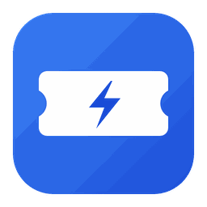
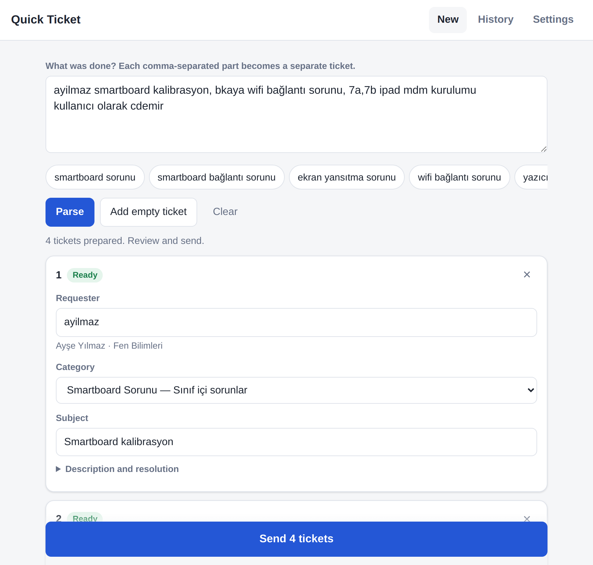
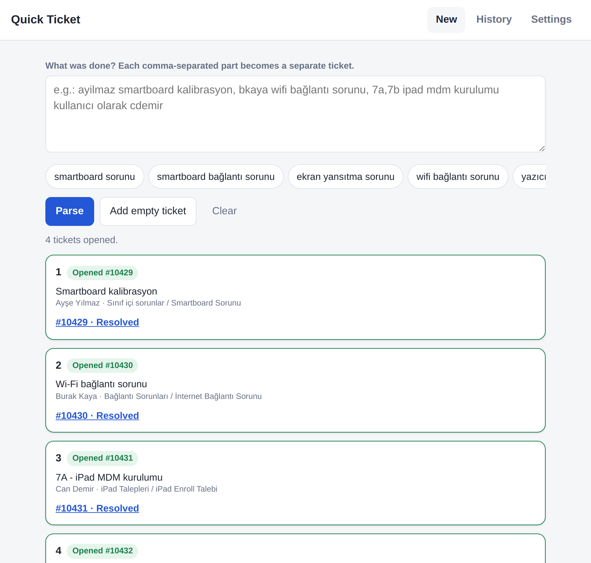
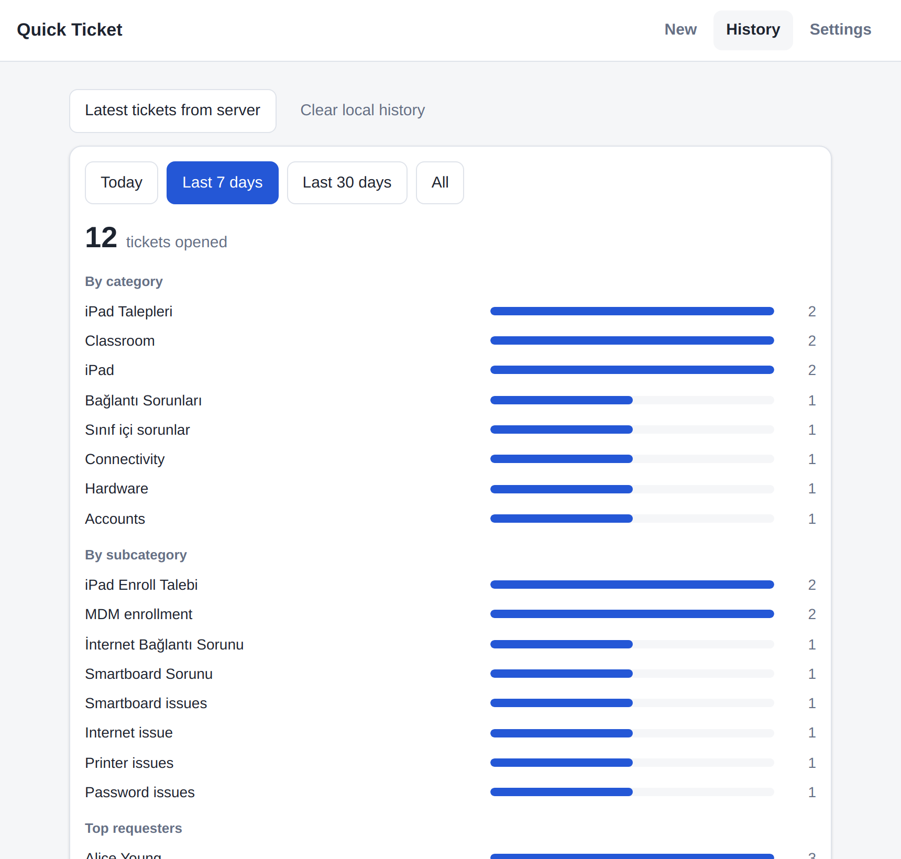
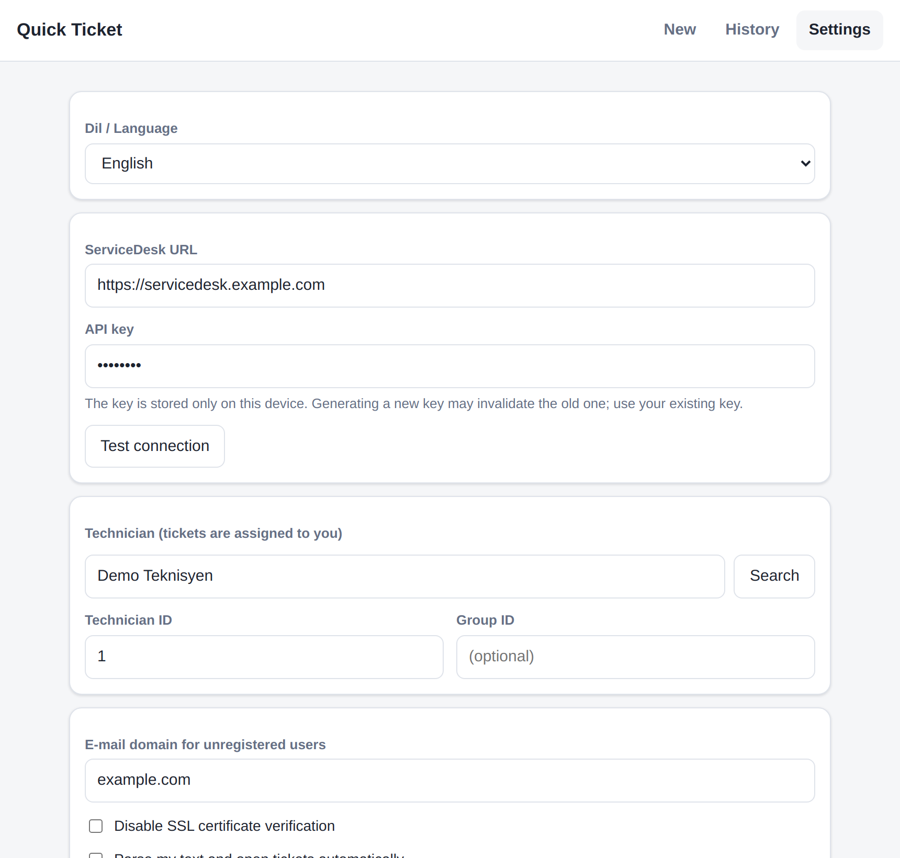
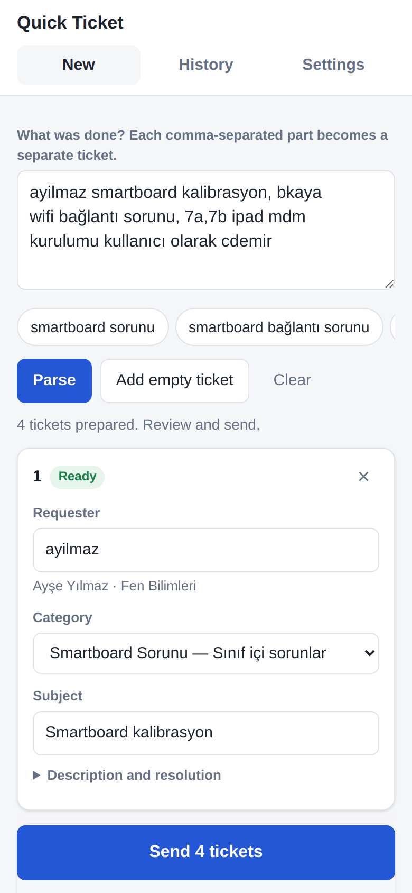
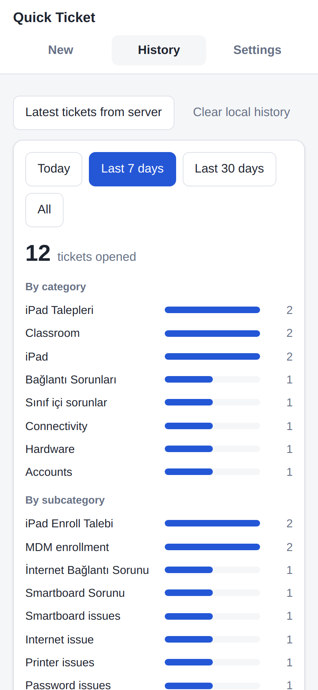

<p align="center">
  
</p>

<h1 align="center">Hızlı Ticket (Quick Ticket)</h1>

<p align="center">
  <b>Open several ManageEngine ServiceDesk Plus tickets from a single line of text.</b><br>
  Windows · macOS · Android — Türkçe / English
</p>

<p align="center">
  <a href="../../releases/latest"><b>⬇️ Download (latest release)</b></a> ·
  <a href="README.md">🇹🇷 Türkçe</a>
</p>

---

Instead of filling in a form for every job you did today, **type what you did in one line**. Quick Ticket parses the text, turns each job into a separate ticket, finds the requester and the category, opens the ticket and closes it as **Resolved**.

```
ayilmaz smartboard kalibrasyon, bkaya wifi bağlantı sorunu, 7a,7b ipad mdm kurulumu kullanıcı olarak cdemir
```
➡️ 4 tickets: requesters are looked up in SDP, categories are picked automatically, classes like `7a,7b` become separate tickets.

<p align="center">
  
  
</p>

## Features

- ✍️ **Tickets from free text** — every comma-separated part becomes its own ticket.
- 👤 **Finds the requester** — searches SDP by username, e-mail or full name; unregistered users are created by e-mail.
- 🗂️ **Guesses the category** — keyword rules plus **learning** from your corrections; can import categories straight from SDP.
- ✅ **Opens and resolves** — writes the resolution text and sets the status to *Resolved*.
- 🏫 **Class support** — `7a,7b ipad setup` → one ticket per class.
- 🎙️ **Dictation** — microphone button on Android; `Win+H` on Windows, `Fn` twice on macOS.
- 📊 **History & summary** — today / 7 days / 30 days; breakdown by category, requester and day.
- ⚡ **Quick buttons** — add frequent jobs with one tap.
- 🌐 **Turkish / English UI** — Settings → *Dil / Language*.
- 🔒 **Privacy** — the API key is stored only on your device; there is no middle server, requests go straight to your SDP server.

<p align="center">
  
  
</p>
<p align="center">
  
  
</p>

## Installation

All files are on the **[Releases](../../releases/latest)** page.

| Platform | File | Notes |
|---|---|---|
| **Windows** | `HizliTicket-x.y.z-Setup.exe` | Installer. Use `…-Portable.exe` to run without installing. On a SmartScreen warning choose *More info → Run anyway*. |
| **macOS** (Intel + Apple Silicon) | `HizliTicket-x.y.z-mac-arm64.dmg` (M1/M2/M3/M4) or `…-mac-x64.dmg` (Intel) | Open the DMG and drag the app to *Applications*. See the note below for the first launch. |
| **Android** (7.0+) | `HizliTicket-x.y.z-android.apk` | Open it on the phone; you may need to allow installs from unknown sources. |

> **macOS first launch:** the app is not signed with an Apple developer certificate, so the first time *right-click the app in Finder → Open → Open*. If macOS says the app is "damaged", run this once in Terminal:
> ```bash
> xattr -cr "/Applications/Hizli Ticket.app"
> ```

## First-time setup

1. Open the **Settings** tab.
2. **ServiceDesk URL**: e.g. `https://servicedesk.yourcompany.com`
3. **API key**: in SDP, profile menu (top right) → *Personalize / API Key*. (Generating a new key may invalidate the old one; reuse your existing key if you have one.)
4. **Test connection**.
5. **Technician**: type your name, press **Search** and **Select** yourself (tickets are assigned to you). Optionally enter a **Group ID**.
6. **E-mail domain**: used for users not registered in SDP (`username@yourcompany.com`).
7. Press **Learn categories from SDP** to load your organisation's own category tree.

Settings are saved automatically.

## Usage

| You type | Result |
|---|---|
| `ayilmaz yazıcı sorunu` | A *printer issue* ticket for user `ayilmaz` |
| `ayilmaz yazıcı sorunu, bkaya şifre sıfırlama` | 2 tickets for two different users |
| `7a,7b ipad mdm kurulumu kullanıcı olarak cdemir` | One ticket per class, requester `cdemir` |
| `Ayşe Yılmaz smartboard kalibrasyon` | Requester looked up by full name |

- With **auto-open** on (default) complete tickets are opened immediately; incomplete ones stay as cards — fill them in and press **Send**.
- With it off, press **Parse** for a preview, review, then **Send**.
- If you correct a category on a card, the app **learns** it and picks it next time.
- `Ctrl/Cmd + Enter` parses quickly.

> The text parser uses Turkish keywords (smartboard, wifi, ipad, yazıcı, şifre…). Categories learned from SDP and your manual corrections work in any language.

## Running from source

```bash
npm install
npm start              # desktop (Electron)
npm run dist:win       # Windows installer + portable
npm run dist:mac       # macOS .dmg (on a Mac)
cd android && gradle assembleRelease   # Android APK (needs the Android SDK)
```

Project layout:

```
www/        Shared UI (HTML/CSS/JS) used by every platform
desktop/    Electron shell (Windows / macOS / Linux)
android/    Android WebView shell + native HTTP bridge
.github/    CI: every push builds the EXE, DMG and APK and attaches them to Releases
```

## License

[MIT](LICENSE)
