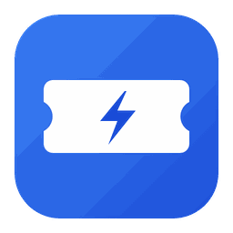
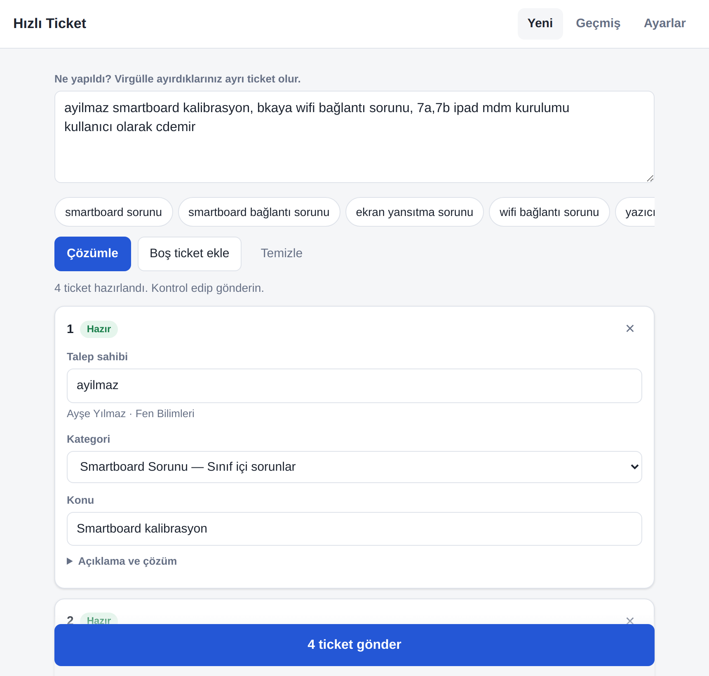
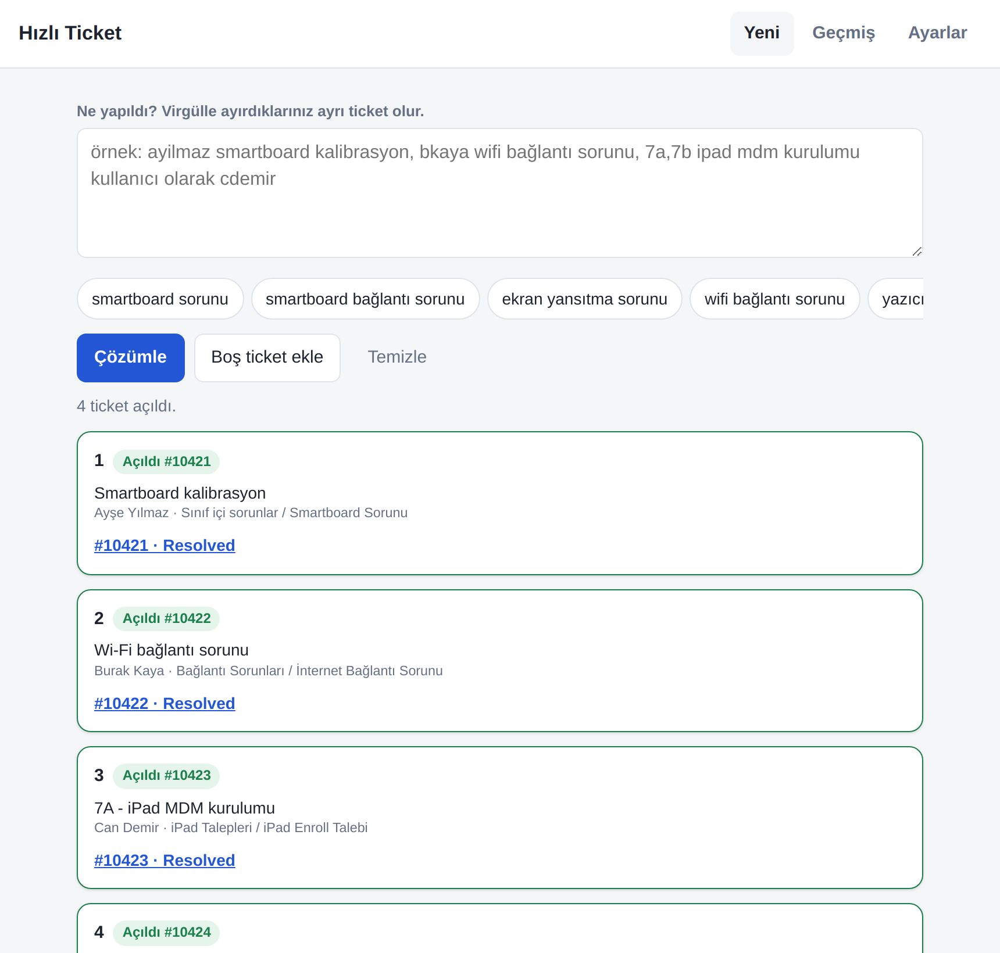
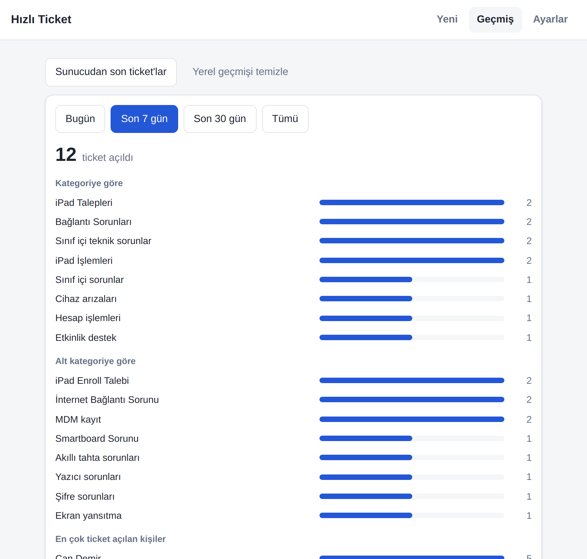
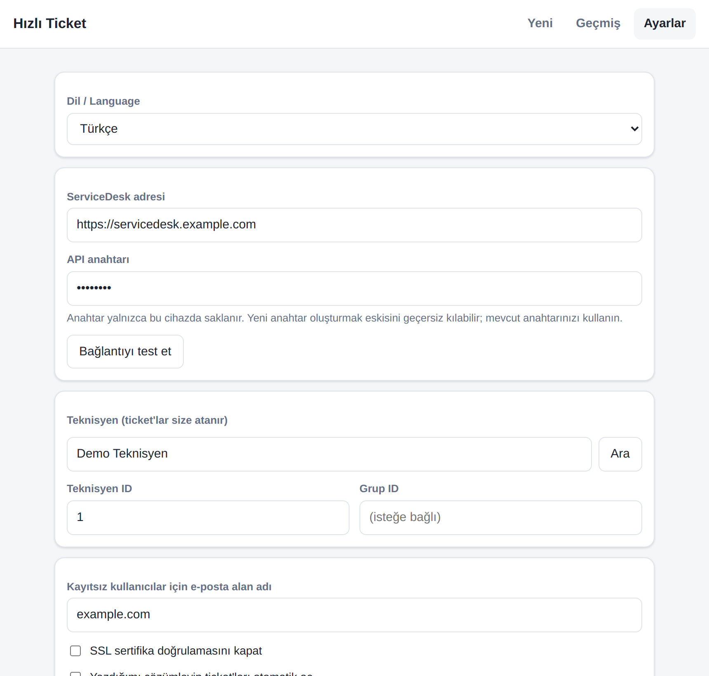
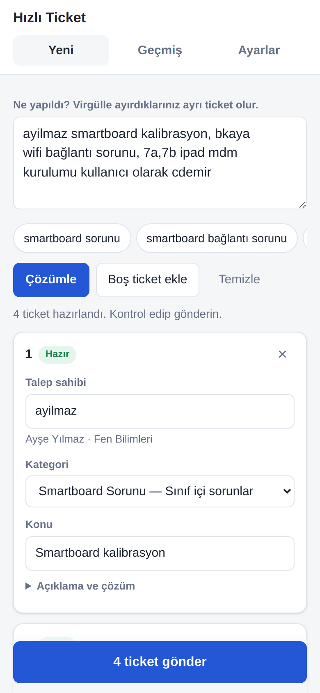
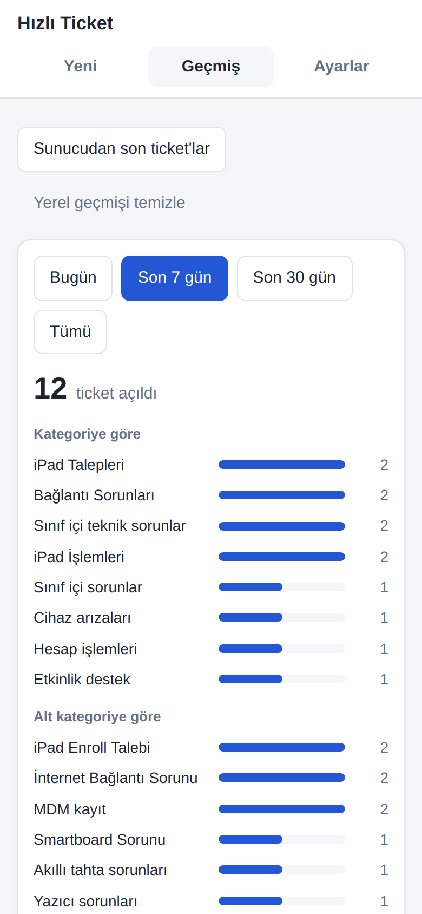

<p align="center">
  
</p>

<h1 align="center">Hızlı Ticket</h1>

<p align="center">
  <b>ManageEngine ServiceDesk Plus için tek satırda, birden çok ticket açın.</b><br>
  Windows · macOS · Android — Türkçe / English
</p>

<p align="center">
  <a href="../../releases/latest"><b>⬇️ İndir (son sürüm)</b></a> ·
  <a href="README.en.md">🇬🇧 English</a>
</p>

---

Gün içinde yaptığınız işleri tek tek form doldurarak kaydetmek yerine, ne yaptığınızı **tek satırda yazın**; Hızlı Ticket metni çözümler, her işi ayrı bir ticket'a dönüştürür, talep sahibini ve kategoriyi bulur, ticket'ı açar ve **Resolved** olarak kapatır.

```
ayilmaz smartboard kalibrasyon, bkaya wifi bağlantı sorunu, 7a,7b ipad mdm kurulumu kullanıcı olarak cdemir
```
➡️ 4 ayrı ticket: kullanıcılar SDP'de aranır, kategoriler otomatik seçilir, `7a,7b` gibi sınıflar ayrı ticket olur.

<p align="center">
  
  
</p>

## Özellikler

- ✍️ **Serbest metinden ticket** — virgülle ayırdığınız her parça ayrı ticket olur.
- 👤 **Talep sahibini bulur** — kullanıcı adı, e-posta veya ad soyad ile SDP'de arar; kayıtlı değilse e-posta ile oluşturur.
- 🗂️ **Kategoriyi tahmin eder** — anahtar kelime kuralları + sizin düzeltmelerinizden **öğrenir**; kategorileri doğrudan SDP'den çekebilir.
- ✅ **Açar ve kapatır** — çözüm metnini yazar, durumu *Resolved* yapar.
- 🏫 **Sınıf desteği** — `7a,7b ipad kurulumu` → her sınıf için ayrı ticket.
- 🎙️ **Sesle yazma** — Android'de mikrofon düğmesi; Windows'ta `Win+H`, macOS'ta `Fn` iki kez.
- 📊 **Geçmiş ve özet** — bugün / 7 gün / 30 gün; kategoriye, kişiye ve güne göre dağılım.
- ⚡ **Hızlı düğmeler** — sık yaptığınız işleri tek dokunuşla ekleyin.
- 🌐 **Türkçe / English arayüz** — Ayarlar → *Dil / Language*.
- 🔒 **Gizlilik** — API anahtarı yalnızca cihazınızda saklanır; aradaki sunucu yok, istekler doğrudan sizin SDP sunucunuza gider.

<p align="center">
  
  
</p>
<p align="center">
  
  
</p>

## Kurulum

Tüm dosyalar **[Releases](../../releases/latest)** sayfasındadır.

| Platform | Dosya | Not |
|---|---|---|
| **Windows** | `HizliTicket-x.y.z-Setup.exe` | Kurulum sihirbazı. Kurulumsuz kullanım için `…-Portable.exe`. SmartScreen uyarısında *Ek bilgi → Yine de çalıştır*. |
| **macOS** (Intel + Apple Silicon) | `HizliTicket-x.y.z-mac-arm64.dmg` (M1/M2/M3/M4) veya `…-mac-x64.dmg` (Intel) | DMG'yi açıp uygulamayı *Applications*'a sürükleyin. İlk açılışta aşağıdaki nota bakın. |
| **Android** (7.0+) | `HizliTicket-x.y.z-android.apk` | Telefonda açın; "bilinmeyen kaynaklardan yükleme" izni isteyebilir. |

> **macOS ilk açılış:** Uygulama Apple geliştirici sertifikasıyla imzalı olmadığı için ilk seferde *Finder'da uygulamaya sağ tık → Aç → Aç* deyin. "Hasarlı" uyarısı alırsanız Terminal'de bir kez şunu çalıştırın:
> ```bash
> xattr -cr "/Applications/Hizli Ticket.app"
> ```

## İlk ayarlar

1. **Ayarlar** sekmesini açın.
2. **ServiceDesk adresi**: örn. `https://servicedesk.kurumunuz.com`
3. **API anahtarı**: SDP'de sağ üstteki profil menüsü → *Kişisel Ayarlar / API Key*. (Yeni anahtar üretmek eskisini geçersiz kılabilir; varsa mevcut anahtarınızı kullanın.)
4. **Bağlantıyı test et**.
5. **Teknisyen**: adınızı yazıp **Ara** → kendinizi **Seç**. (Ticket'lar size atanır.) İsterseniz **Grup ID** girin.
6. **E-posta alan adı**: SDP'de kayıtlı olmayan kullanıcılar için kullanılır (`kullaniciadi@kurumunuz.com`).
7. **Kategorileri SDP'den öğren** düğmesine basın — kendi kurumunuzun kategori listesi yüklenir.

Ayarlar otomatik kaydedilir.

## Kullanım

| Yazdığınız | Sonuç |
|---|---|
| `ayilmaz yazıcı sorunu` | `ayilmaz` kullanıcısı için *Yazıcı sorunu* ticket'ı |
| `ayilmaz yazıcı sorunu, bkaya şifre sıfırlama` | 2 ticket, iki farklı kullanıcı |
| `7a,7b ipad mdm kurulumu kullanıcı olarak cdemir` | Her sınıf için ayrı ticket, talep sahibi `cdemir` |
| `Ayşe Yılmaz smartboard kalibrasyon` | Ad soyad ile kullanıcı araması |

- **Otomatik aç** açıksa (varsayılan), eksiksiz ticket'lar doğrudan açılır; eksik olanlar kart olarak kalır, tamamlayıp **Gönder**'e basarsınız.
- Kapalıysa önce **Çözümle** ile önizleme alır, kontrol edip **Gönder**'e basarsınız.
- Kartta kategoriyi elle düzeltirseniz uygulama bunu **öğrenir** ve bir dahaki sefere kendisi seçer.
- `Ctrl/Cmd + Enter` ile hızlıca çözümleyebilirsiniz.

> Metin çözümleyici Türkçe anahtar kelimelerle çalışır (smartboard, wifi, ipad, yazıcı, şifre…). Arayüz dili İngilizce olsa da ticket metinlerini bu şekilde yazabilirsiniz; SDP'den öğrenilen kategoriler her dilde çalışır.

## Kaynak koddan çalıştırma

```bash
npm install
npm start              # masaüstü (Electron)
npm run dist:win       # Windows kurulum + portable
npm run dist:mac       # macOS .dmg (macOS'ta)
cd android && gradle assembleRelease   # Android APK (Android SDK gerekir)
```

Proje yapısı:

```
www/        Ortak arayüz (HTML/CSS/JS) — tüm platformlar bunu kullanır
desktop/    Electron kabuğu (Windows / macOS / Linux)
android/    Android WebView kabuğu + yerel HTTP köprüsü
.github/    Otomatik derleme: her push'ta EXE, DMG ve APK üretilip Releases'a eklenir
```

## Lisans

[MIT](LICENSE)
